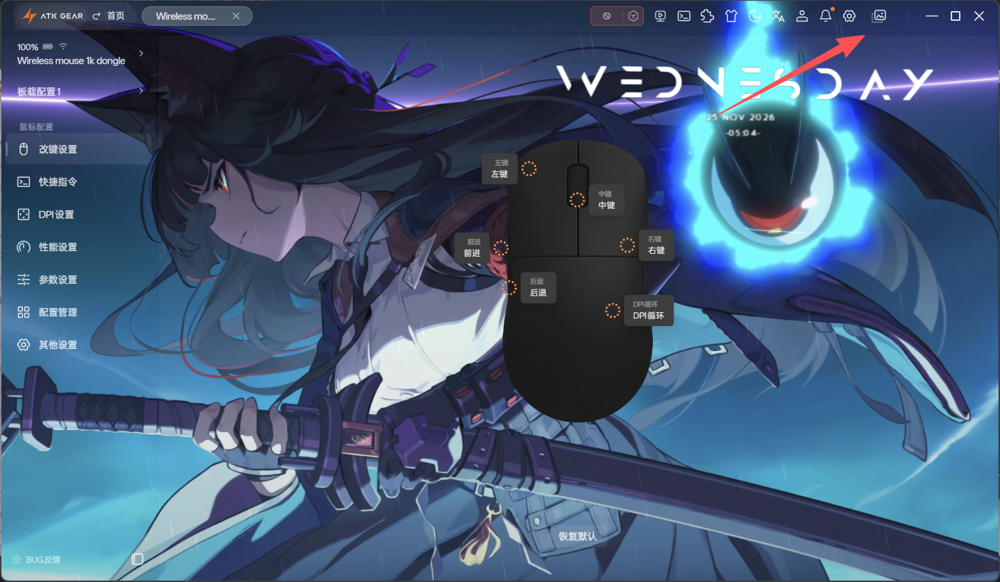
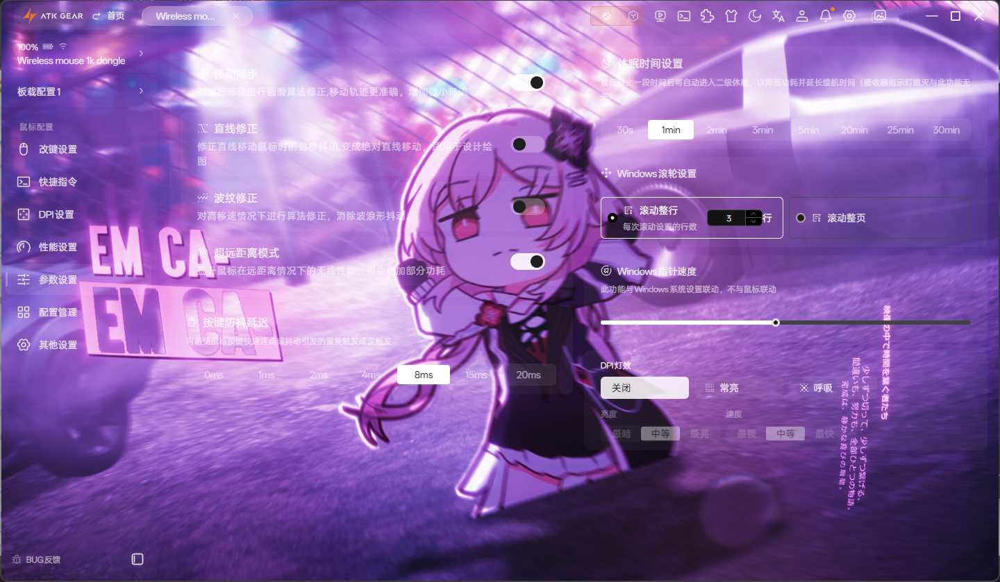
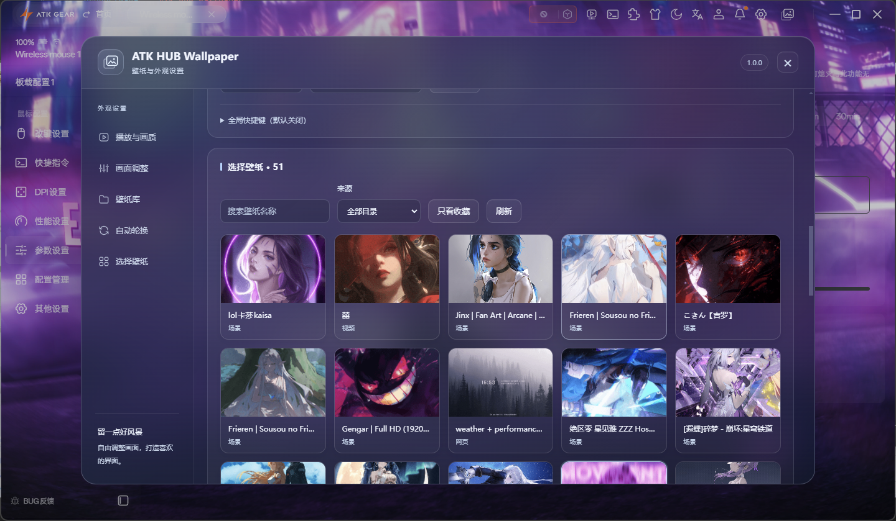
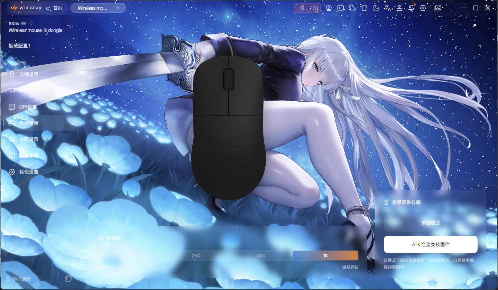

# ATK HUB Wallpaper

键鼠挑好了，灯效也调顺眼了，打开驱动时，也想看到自己喜欢的画面。

**ATK HUB Wallpaper** 可以给 ATK HUB 换上喜欢的图片、视频或兼容的动态壁纸。调 DPI、改按键、切回报率的时候，驱动界面也能有一点自己的风格。

这是一个为兴趣和娱乐做的小项目，免费分享，**限非商业使用**。壁纸只显示在 ATK HUB 内。本项目为非官方插件。

当前版本 **1.0.0**，支持 **Windows 64 位**，已在 **ATK HUB 3.2.33** 上验证。其他 HUB 版本请先用安装器检测。

[下载安装包](https://github.com/D-O-King/atkhub-wallpaper-plugin/releases) · [反馈问题](https://github.com/D-O-King/atkhub-wallpaper-plugin/issues)

## 先看看效果

### 壁纸设置入口在这里

右上角的叠层图片图标就是入口，红色箭头已经标出来了。

### 调参数，也能有喜欢的背景

换好壁纸后，照常调整鼠标参数。画面太亮、文字不够清楚，可以在壁纸设置里调暗一点，或加些模糊。

### 喜欢的壁纸，收起来换着用

在毛玻璃面板里看预览、搜名称、切换来源，也可以收藏常用壁纸，或者开自动轮换。

### 换张壁纸，换种氛围

设备性能设置页面也能显示壁纸，可以按自己的桌搭、灯效和喜好搭配。

截图中的壁纸用于效果演示，素材版权归各自作者所有。

## 可以怎么玩

- **用自己的壁纸。** 支持图片、视频，以及兼容的网页和场景壁纸；视频默认静音。
- **收藏、搜索、自动换。** 壁纸多了也方便找，还能只在收藏里轮换。
- **把画面调舒服。** 调整亮度、遮暗、模糊和饱和度，兼顾背景效果与设置文字的可读性；图片、视频还可以调整填充方式和位置。
- **颜色直接选。** 点击色块挑颜色，也能输入色号，一键恢复壁纸默认色。常见壁纸属性会显示中文。
- **按电脑情况选画质。** 场景壁纸提供省电、均衡、高画质三个档位，也可以开启“隐藏窗口时暂停”。
- **保留壁纸原有的小互动。** 兼容的网页、场景支持悬停和点击；具体怎么玩，取决于壁纸作者做了什么。

## 装起来很简单

1. 到 [Releases](https://github.com/D-O-King/atkhub-wallpaper-plugin/releases) 下载发布包，解压后运行 **ATK-HUB-Wallpaper-Plugin.exe**。
2. 确认 ATK HUB 的安装位置。默认是 `C:\Program Files\ATK HUB`，先点“检测”，再点“安装 / 更新”。写入安装目录时可能需要管理员权限。
3. 建议先退出 HUB。检测到它仍在运行时，安装器会询问是否强制关闭；正在保存设备配置或升级固件时，请先完成操作。
4. 看到安装成功提示后，重新打开 HUB，点击右上角的**叠层图片图标**，就能选壁纸了。

安装器底部也有[项目主页](https://github.com/D-O-King/atkhub-wallpaper-plugin)链接，之后找更新或反馈问题更方便。

## 壁纸从哪里来

可以使用自己保存的图片、视频，也可以添加已经下载好的完整壁纸项目。

插件会尝试发现 Steam 壁纸目录。没有找到，或者素材放在 WeGame、其他硬盘里，就点“添加壁纸库”，选择对应文件夹。完整动态项目请选择包含 `project.json` 的目录，不要只放一张预览图。

新加了壁纸后，在“选择壁纸”里点一下“刷新”。插件本身不下载创意工坊资源，也不附带截图里的壁纸。

## 用之前可能会想问

### 必须安装 Wallpaper Engine 吗？

不必安装或运行 Wallpaper Engine。普通图片、视频可以直接用，动态与交互壁纸需要本机已有完整素材。下载安装包即可使用，无需额外搭建开发环境。

### 所有动态壁纸都能用吗？

目前还做不到。部分壁纸依赖原版引擎、联网资源或特殊效果，可能显示不完整，也可能无法播放。有可用预览图时，加载失败会退回预览。

网页和场景的画面布局也由原壁纸决定，不保证都能像普通图片一样自由裁剪。

### 为什么点了壁纸没有反应？

先确认这张壁纸本身带互动。有些效果要按住拖动，单击不会触发。

HUB 的设备卡片、按钮和输入框会优先响应。请在没有被这些控件遮住的壁纸区域尝试；不兼容的互动效果仍可能无法触发。

### 高画质有点卡，怎么调？

先试“均衡”，更在意占用就选“省电”。场景壁纸三个档位分别以 15、30、60 FPS 为目标，实际流畅度还要看壁纸复杂程度、窗口大小和电脑性能。

也可以开启“隐藏窗口时暂停”，收起 HUB 后让壁纸休息一下。

### 不想用了，怎么还原？

临时换回 HUB 背景，在壁纸设置里点“恢复 HUB 背景”。想移除插件，就重新运行安装器，选择“卸载还原”。原始备份和个人配置会保留。

HUB 官方更新后，如果壁纸入口消失，重新运行插件安装器即可。插件更新也使用“安装 / 更新”，完成后重启 HUB。

## 有问题一起反馈

欢迎到 [Issues](https://github.com/D-O-King/atkhub-wallpaper-plugin/issues) 留言。带上 **HUB 版本、壁纸名称或创意工坊链接、问题描述和截图**，会更容易找到原因。

壁纸兼容性还在逐步完善，遇到问题也可以先换一张，或卸载还原。

## 关于使用和素材

本项目供个人兴趣、娱乐、学习等符合条款的非商业用途使用，自有代码采用 [PolyForm Noncommercial 1.0.0](LICENSE)。商业用途需要另行授权，具体允许范围以许可证为准；转发或修改后分享时，请保留许可和版权通知。

本项目为源码公开、限非商业使用的项目。第三方组件及壁纸素材仍遵守各自授权，详见[第三方组件说明](THIRD-PARTY-NOTICES.md)。此前已经授予的 MIT 权利不受这次许可变更影响。

想自行修改或编译，可以看[构建与验证说明](docs/DEVELOPMENT.md)；发布相关内容见 [GitHub 发布准备](docs/PUBLISHING.md)，历史来源见[代码来源记录](docs/PROVENANCE.md)。
